<div align="center">

<picture>
  <source media="(prefers-color-scheme: dark)" srcset="docs/readme/logo-dark.png">
  <source media="(prefers-color-scheme: light)" srcset="docs/readme/logo-light.png">
  
</picture>

<br><br>


<br><br>

<p><a href="#-what-it-does"></a>&nbsp;<a href="#-architecture"></a>&nbsp;<a href="#-why-falkordb"></a>&nbsp;<a href="docs/EVAL.md"></a>&nbsp;<a href="#-quick-start"></a></p>

<br>


<br>


</div>

<div align="center">
<a href="docs/demo/neura1-film-narrated.mp4">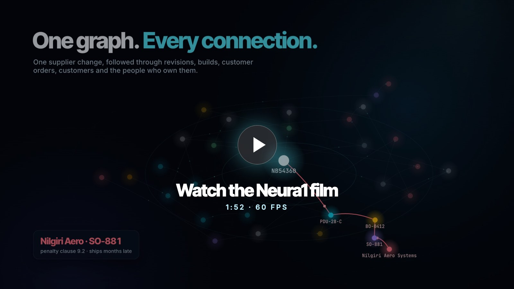</a>
<br>
<sub><b>The Neura1 film</b> (1:52, 60 fps, narrated). Rendered frame by frame from the real product and the real impact data, with a score written for it. <a href="docs/demo/neura1-film-narrated.mp4">Play it</a> · <a href="docs/demo/neura1-film-music.mp4">music-only cut</a>.</sub>
</div>

<br>

## ◆ Who it's for

**Neura1 is a company brain for small and mid-sized hardware manufacturers**: companies of roughly 50 to 500 people
that design and build electronics in low volumes, often to order, for demanding customers in aerospace, defence,
transportation and industry. In these companies one supplier email can break builds, customer orders and delivery
promises, and the knowledge needed to catch it is spread across spreadsheets, chats, documents and a few people's heads.

| It keeps track of | |
|---|---|
| **People and the organisation** | who does what, who backs up whom, who knows what, who is away |
| **Products and parts** | revisions, bills of materials, approved and rejected alternates |
| **Supply** | suppliers, quotes, price and lead-time notices, stock, purchase orders and goods received |
| **Work and customers** | builds, customer orders and their due dates, projects and tasks |
| **What the company knows** | decisions, documents, chats, tickets and meetings, each fact linked to its source |

Part of Neura1 is general: chat, meetings, knowledge health, permissions, briefs and Ask work for any organisation.
The part that traces parts, builds, orders and suppliers is built for manufacturers.

**An add-on to the planning tools a company already has.** Neura1 does not ask anyone to leave their ERP or project
planner. It reads them over the Model Context Protocol (Zoho Inventory and Zoho Projects in the demo), keeps the graph in
step, shows on one timeline where the plan is slipping and why, and lets the agents a team already works with, such as
OpenAI Dots, ask it questions, but only if the company switches that on. Modules can take over from paid tools later, one at a time, when a company is ready.

> [!NOTE]
> **Flyvi Technologies is the reference company, not the limit.** Neura1 was designed around a real manufacturer:
> **Flyvi Technologies Pvt. Ltd.** (part of Datasol (Bangalore) Limited), a Bengaluru maker of power distribution units,
> power converters, battery chargers and embedded control systems for aerospace and defence. Its leadership and people
> are real (first names only). **Every record in this demo is synthetic**: products, customers, orders, prices, decisions,
> tasks, leave and meetings. Customers are fictional, and every number below comes from the running system.
> The graph schema and engines are not specific to Flyvi: another manufacturer's records load into the same model.
> Only the company name in the AI prompts, letters and messages is still written in for Flyvi.

<br>

## ◆ New: the plan, your ERP and your agents

> [!IMPORTANT]
> **Neura1 sits on top of the planning tools a company already has.** Three things make that real:
>
> 1. **[Timeline](#03--it-plans-ahead): the plan, and where it is slipping.** One Gantt of every project, task, build
>    and customer order: the original plan, today's plan, and a forecast worked out by code from stock, open orders,
>    supplier notices, lead times and leave. Every slip explains itself; deviations export for the planner.
> 2. **[Connections](#07--it-works-with-what-you-already-use): the ERP and planner, over MCP.** Neura1 reads Zoho
>    Inventory and Zoho Projects through the Model Context Protocol, compares field by field, validates and loads only
>    what changed. A date moved in Zoho appears on the timeline against the original plan.
> 3. **OpenAI Dots and other agents, over MCP: optional, and off by default.** Nothing leaves Neura1 until a director
>    or leader switches external AI access on in the app. Then a token-protected, read-only endpoint lets Dots, ChatGPT
>    or Claude ask what is slipping, whether a date can be promised and who knows what, with a person's permissions;
>    one switch turns it off again. Inside the app, Ask Neura1 and the `/slips` chat command answer the same questions.
> 4. **[An agent for every department](#06--an-agent-for-every-department).** Procurement, Production, Engineering and
>    Sales agents each check the graph and post what needs attention to their own channel, with their lead's permissions.

<div align="center">
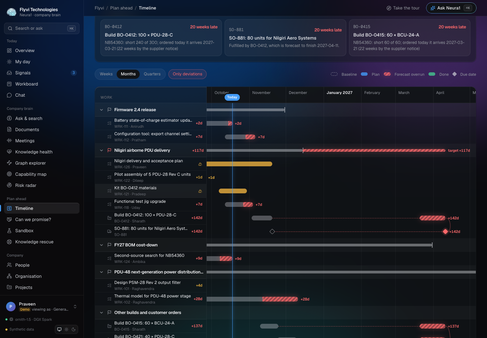
<br>
<sub>Only deviations shown: red is the forecast past the plan. The line from BO-0412 to SO-881 shows which order waits on which build.</sub>
</div>

<br>

## ◆ One morning at a manufacturer

A distributor emails: the **NB54360** regulator goes from **₹250 to ₹320**, and its lead time from **6 to 22 weeks**.
Somewhere a spreadsheet, a Slack thread from 2025 and three people's memories hold the answer to *"what does this
break?"* And someone will suggest the cheaper, "pin-compatible" part that engineering rejected after it shut down at 68 °C.

Neura1 holds the whole company in one FalkorDB graph, so one traversal answers it:

<div align="center">
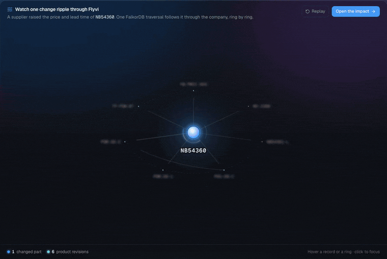
<br>
<sub>One supplier change, traced ring by ring: revisions → builds → orders → customers → people. Hover a record to light its path; click to focus.</sub>
</div>

<br>

| | What Neura1 finds in seconds | How |
|:-:|---|---|
| 🔩 | **3 regulators per PDU-28 Rev C**: two inside the PSM-28 module, one on the board. Draft and obsolete revisions excluded, with the reason. | One variable-length Cypher traversal |
| 🏭 | **3 of 3 planned builds at risk**, **3 customer orders exposed**, one with a late-delivery penalty | Graph + stock allocation in code |
| 💸 | **₹37,400 cost increase** = 420 × (₹320 − ₹250) + ₹8,000 requalification; the expired quote ignored | `Decimal` arithmetic, never the model |
| 🧠 | **"Do not switch to NB54361-L"**: rejected as DEC-117 in March 2025, found in Slack *and* Jira, quoted word for word | Model proposes, code verifies quotes |
| ✅ | **11 tasks for 7 people** from the company's own change policy, approved once, never duplicated | Idempotent actions in the graph |
| 📅 | **SO-881 ships 142 days late and the Nilgiri project misses its target by 117 days**, because BO-0412 waits for NB54360 | Timeline engine: stock and orders allocated in date order, in code |
| 🔌 | **7 changes read from Zoho over MCP**, field by field (stock 320 → 520, a PO received, a due date moved), validated, loaded | MCP client · field diff · import validator |
| 🧑‍🔧 | **An agent for every department**: Procurement, Production, Engineering and Sales each check the graph and post what needs attention to their own channel (12 items on the demo) | Sub-agents in a harness: goal, scoped engines, channel, permissions |
| 🤖 | **OpenAI Dots can ask Neura1** what is slipping and why, only once a leader switches it on, and with a person's permissions | Remote MCP: off by default, token-protected, read-only |

<br>

## ◆ What it does

### 01 · It remembers

<table>
  <tr>
    <td width="50%">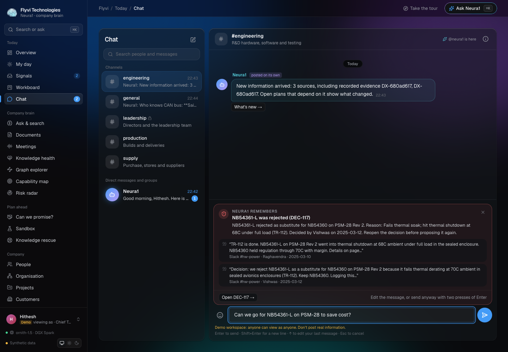<br><sub><b>Never the same mistake twice.</b> While someone types "Can we go for NB54361-L to save cost?", Neura1 shows the 2025 decision and the Slack messages that prove it, before anyone hits send. Sending anyway needs a second Enter, and Neura1 answers in the thread. Rules over the graph, no model, instant.</sub></td>
    <td width="50%"><br><sub><b>Decisions with proof.</b> The model reads Slack, Jira, documents and meetings and proposes decisions; code keeps one only if every quote appears in its source, word for word. One click opens the original message in its thread.</sub></td>
  </tr>
  <tr>
    <td>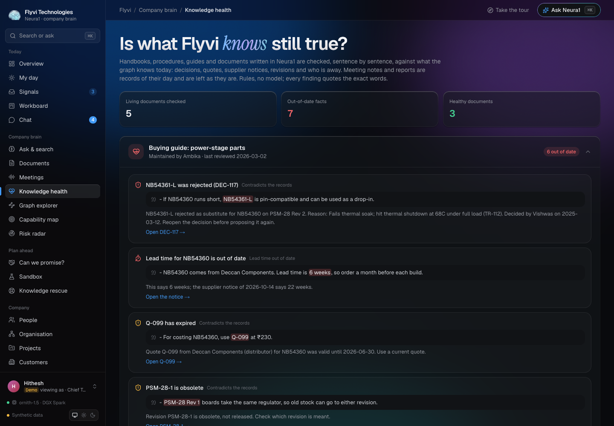<br><sub><b>Knowledge health.</b> Handbooks, procedures and guides are checked sentence by sentence against today's graph. A stale buying guide (written to be out of date) still says "6 weeks", costs with an expired quote and calls the rejected part a drop-in; each finding quotes the words, shows the proof and goes to the page's owner.</sub></td>
    <td>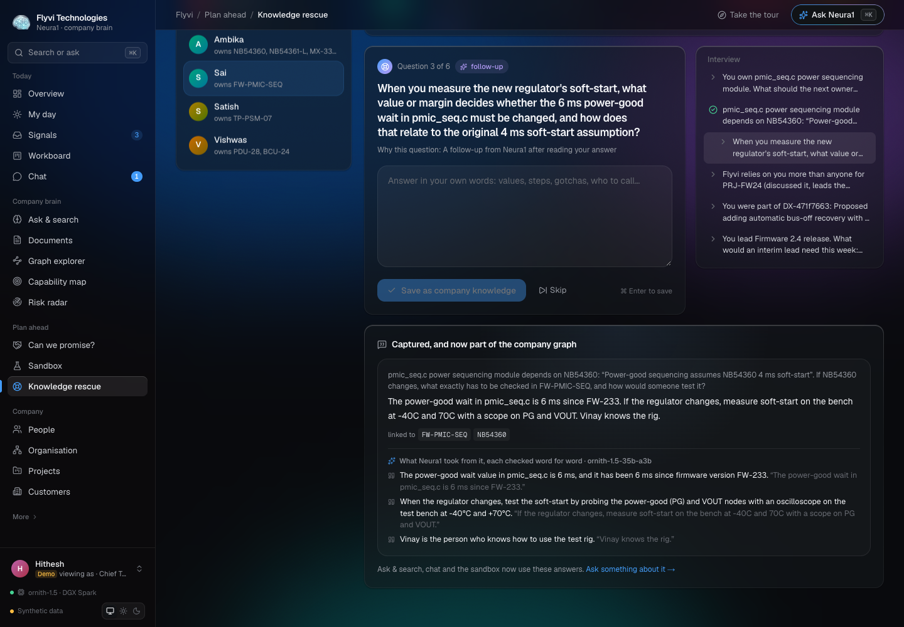<br><sub><b>Knowledge rescue.</b> Before someone leaves, Neura1 interviews them with questions built from the graph: what they own, what depends on it, the decisions they were part of. Answers become linked, searchable knowledge; the DGX keeps only facts it can quote and asks the follow-up a good engineer would.</sub></td>
  </tr>
</table>

### 02 · It understands

<table>
  <tr>
    <td width="50%"><br><sub><b>Change impact.</b> Headline numbers, the rejected-part banner, the evidence graph and who needs to do what, with every Cypher query and its timing one click away.</sub></td>
    <td width="50%">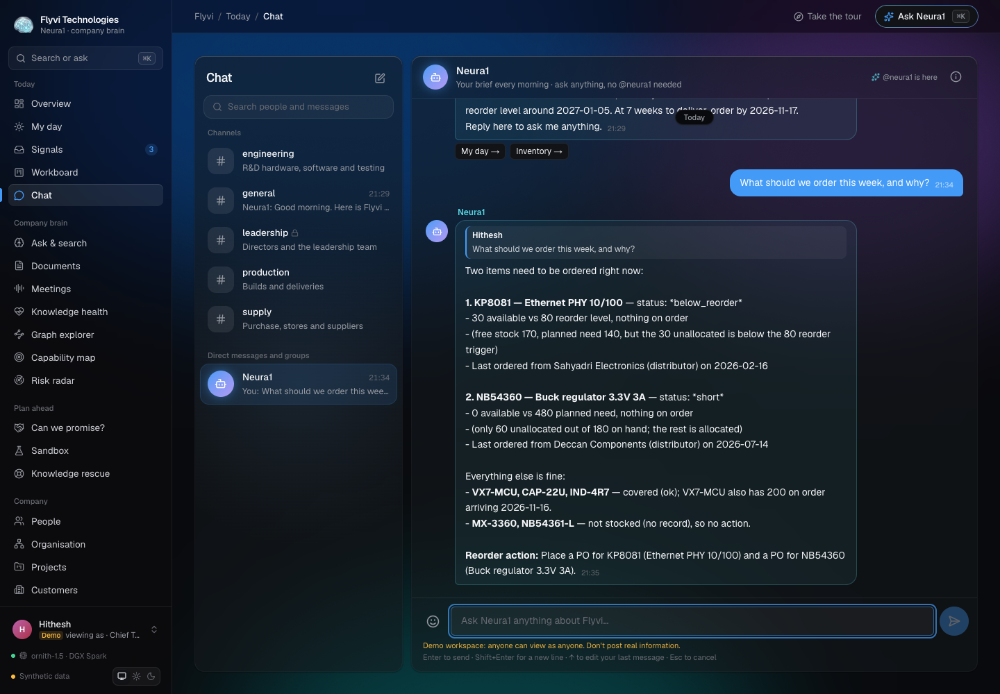<br><sub><b>Ask anything.</b> An agent plans its own steps over 27 bounded graph tools and read-only Cypher, and cites its sources. "What should we order this week, and why?" is answered on the DGX from inventory, drafted orders and supplier notices.</sub></td>
  </tr>
  <tr>
    <td><br><sub><b>Risk radar.</b> FalkorDB betweenness centrality and label propagation find chokepoints, single-sourced parts, one-person knowledge and how work really clusters.</sub></td>
    <td>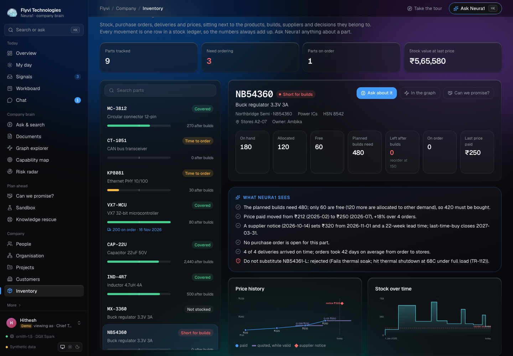<br><sub><b>Inventory.</b> Stock against what the planned builds need, every order and delivery, a price history (paid, quoted, announced), supplier reliability and a stock ledger that always adds up.</sub></td>
  </tr>
</table>

### 03 · It plans ahead

<table>
  <tr>
    <td width="50%"><br><sub><b>The plan, and where it is slipping.</b> Every project, task, build and customer order on one Gantt. The outline is the first plan recorded, the bar is today's plan, red hatching is the forecast, worked out by code from stock, open purchase orders, supplier notices, lead times and leave. Lines show which order waits on which build.</sub></td>
    <td width="50%">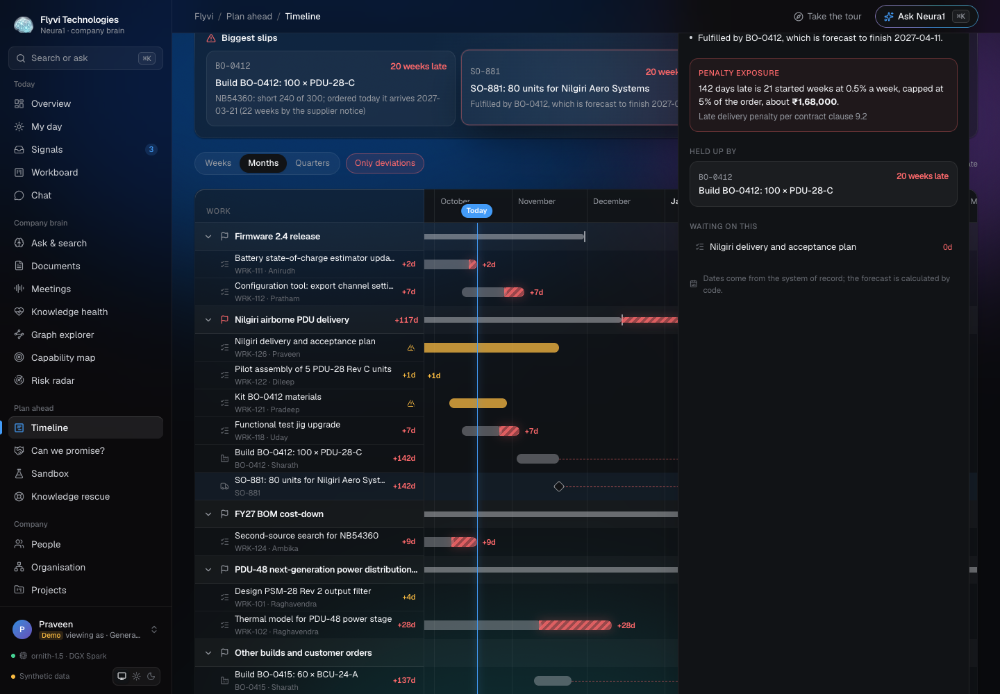<br><sub><b>Every slip explains itself.</b> SO-881 ships 142 days late because BO-0412 waits for NB54360, at 22 weeks by the supplier notice. The penalty clause is worked out for the directors and leadership only, and the date matches "Can we promise?" exactly. Deviations export as CSV for the planner.</sub></td>
  </tr>
  <tr>
    <td width="50%">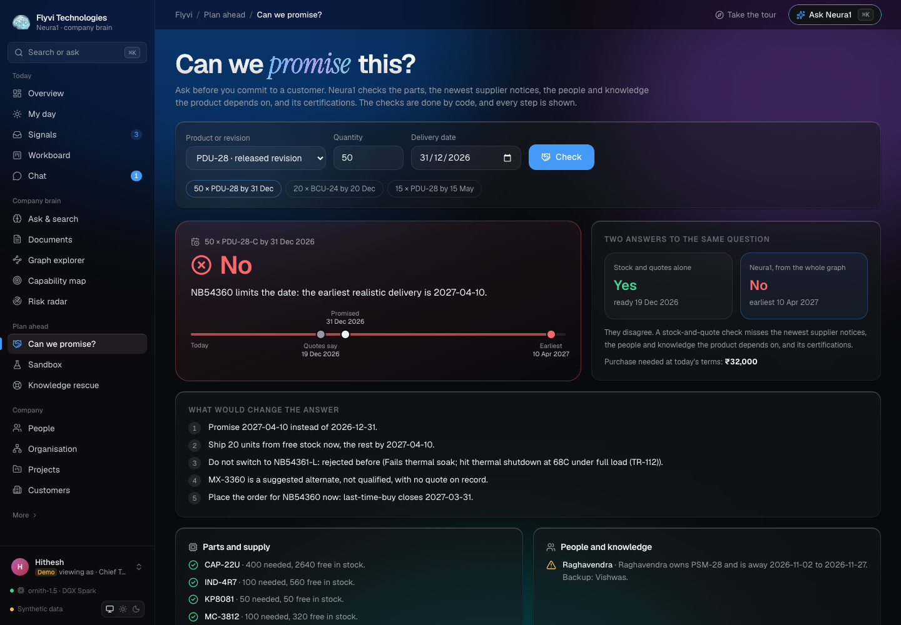<br><sub><b>Can we promise this?</b> "50 × PDU-28 by 31 December?" Stock and quotes alone say yes. Neura1 says no: the supplier notice of 14 October moved NB54360 to 22 weeks, so the honest date is 10 April 2027. It checks people, knowledge and certifications too, and says what would change the answer.</sub></td>
    <td width="50%">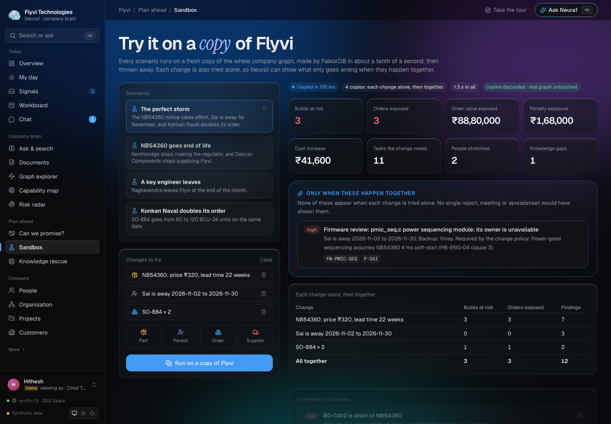<br><sub><b>A sandbox for the whole company.</b> FalkorDB copies the company graph in about 0.1 s. A scenario runs on the copy, each change alone and then together, and the copy is thrown away. What only breaks in combination is called out: the regulator change needs Sai's firmware review in the very weeks Sai is away.</sub></td>
  </tr>
  <tr>
    <td>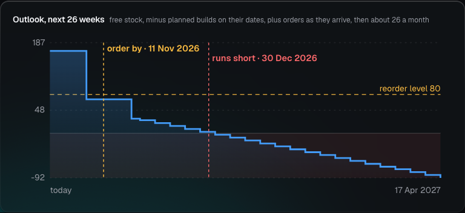<br><sub><b>Stock-outs, predicted.</b> Free stock projected 26 weeks ahead: planned builds on their dates, open orders as they arrive, then last year's usage. KP8081 runs short on 30 December; at the seven weeks recent orders actually took, order by 11 November.</sub></td>
    <td><br><sub><b>Capability map.</b> What Flyvi can do, from recorded work: the model tags tasks with skills from Flyvi's own list (code rejects anything else). Where Flyvi is thin is shown; no scores or rankings exist anywhere.</sub></td>
  </tr>
</table>

### 04 · It acts

<table>
  <tr>
    <td width="50%">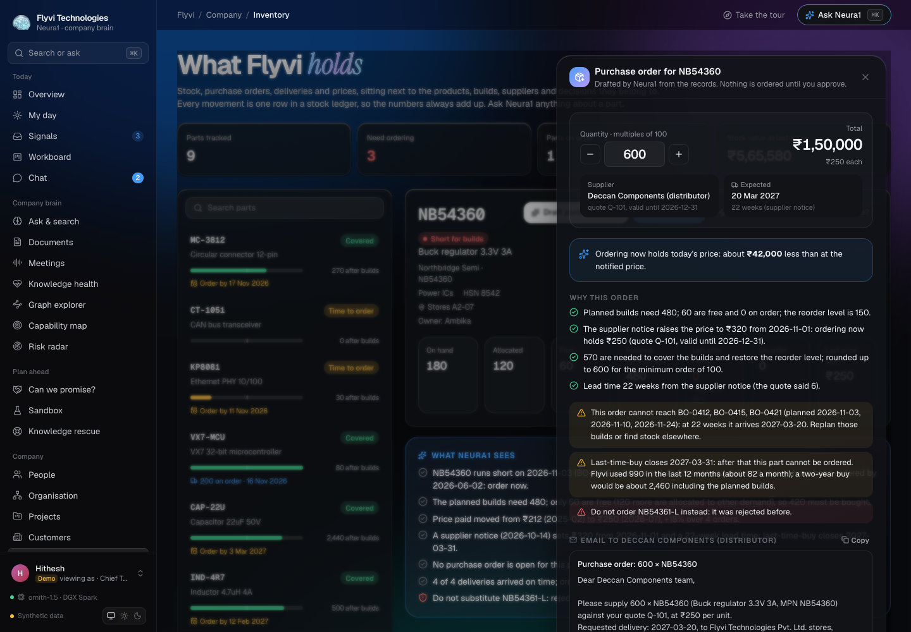<br><sub><b>Neura1 drafts the order; a person approves it.</b> 600 × NB54360 from Deccan at ₹250, about ₹42,000 less than after the notified rise. It says which builds this order cannot reach, sizes a last-time-buy from real usage, refuses the rejected part and drafts the supplier email. Receiving books the goods receipt and the stock ledger together.</sub></td>
    <td width="50%">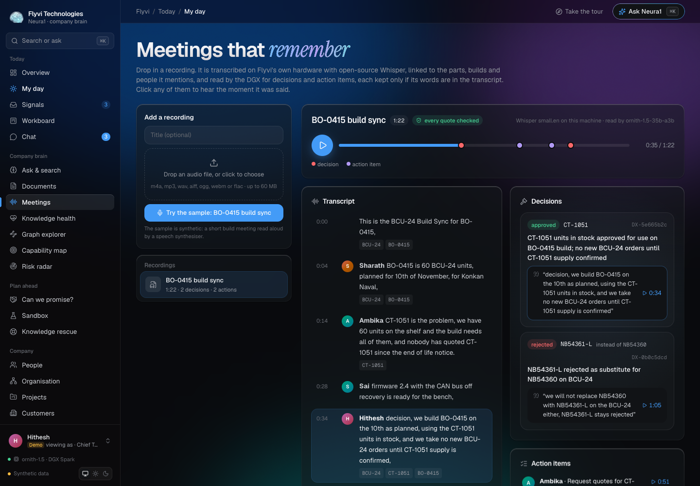<br><sub><b>Meetings that remember.</b> A recording is transcribed on Flyvi's own machine by open-source Whisper, primed with names and part numbers from the graph. The DGX finds decisions and action items, and only what it can quote from the transcript is kept. Click a decision to hear the moment it was made.</sub></td>
  </tr>
  <tr>
    <td>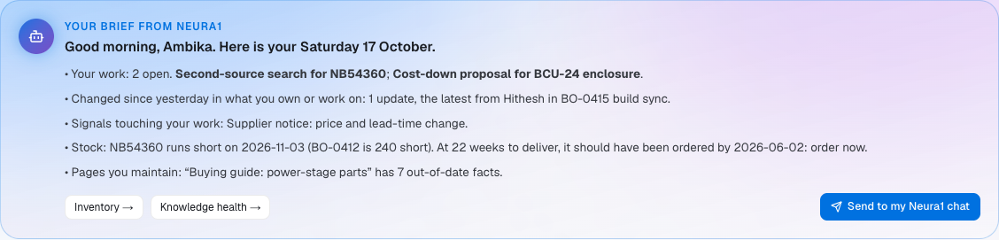<br><sub><b>A brief for each person.</b> At 09:00 everyone gets their own brief in a private Neura1 conversation: their work, what waits for them, stock running short on their parts, out-of-date pages they maintain. Only what that person may see.</sub></td>
    <td><br><sub><b>The team works inside the brain.</b> A full messenger (channels, DMs, groups, replies, reactions, read receipts) where every channel message becomes linked knowledge, and slash commands answer from the graph.</sub></td>
  </tr>
  <tr>
    <td><br><sub><b>Documents written with the brain.</b> A Word editor (SuperDoc) with change notices drafted from the graph, a rule-based fact check and AI edits as tracked changes.</sub></td>
    <td>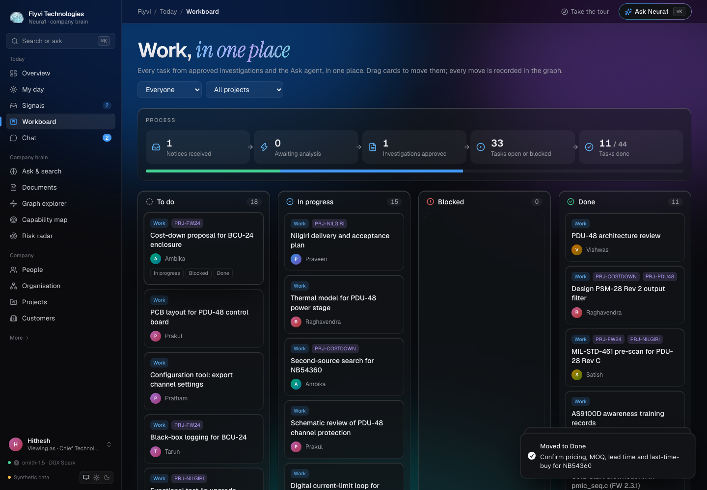<br><sub><b>From plan to done.</b> Approved plans land on the Workboard with their evidence; finished work feeds the capability map and the morning brief.</sub></td>
  </tr>
</table>

### 05 · It respects who may see what

<table>
  <tr>
    <td width="50%"><br><sub><b>Permissions from the graph.</b> Flyvi in three tiers: the directors, the leadership team under them, and employees. Money and leave plans are visible to the directors and leadership (leave also to the person and their backup), in every screen, chat reply, document and agent answer.</sub></td>
    <td width="50%"><br><sub><b>Private by design.</b> An employee sees the same map with counts only, amounts redacted everywhere, and direct messages that never become searchable knowledge. "View as anyone" is a demo control; in production, people sign in through company SSO.</sub></td>
  </tr>
</table>

### 06 · An agent for every department

<table>
  <tr>
    <td>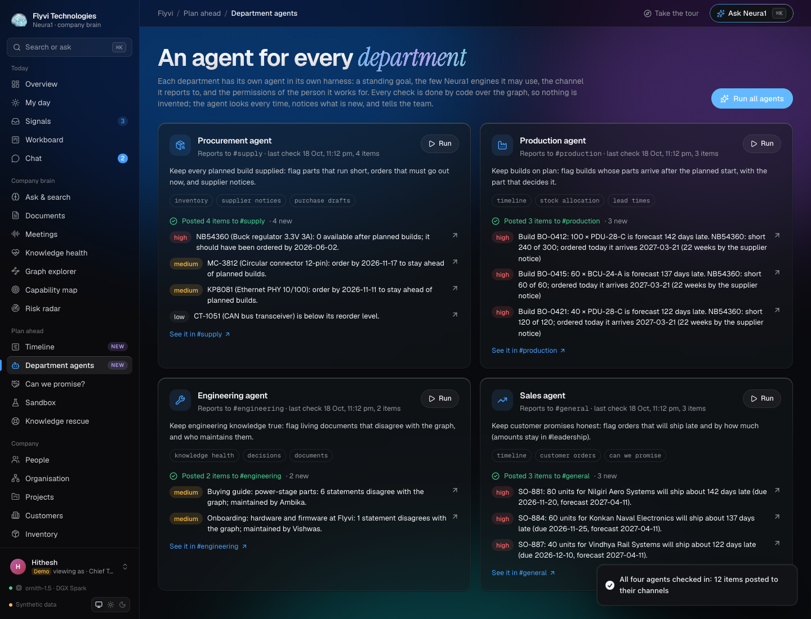<br><sub><b>Sub-agents with a harness.</b> Each department has its own agent: a standing goal, the few Neura1 engines it may use, the channel it reports to and the permissions of the person it works for. Procurement flags parts to order, Production flags builds that cannot start on time, Engineering flags documents that disagree with the graph, and Sales flags orders that will ship late (amounts stay in #leadership). Every check is code over the graph, so nothing is invented, and each pass reports what is new since the last one. Agents read and post; tasks and purchase orders stay a human approval.</sub></td>
  </tr>
</table>

### 07 · It works with what you already use

<table>
  <tr>
    <td>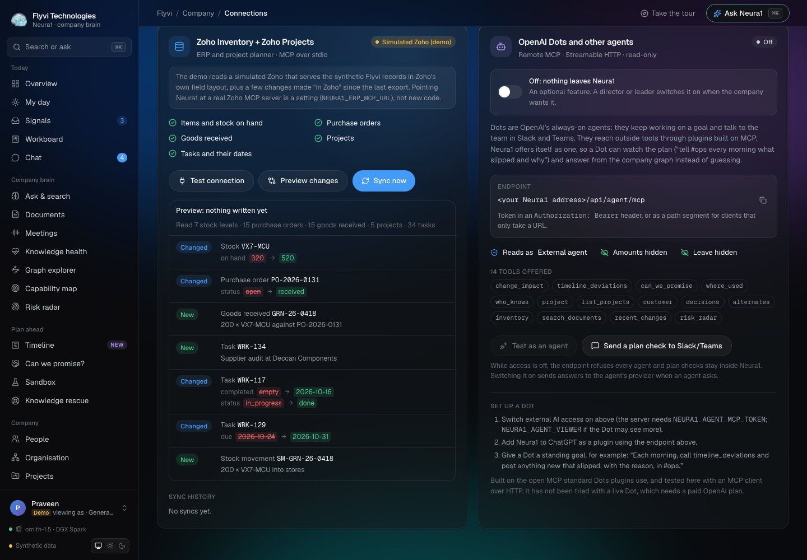<br><sub><b>Your ERP and planner, over MCP; your agents, over MCP.</b> Neura1 Connect calls Zoho's tools (items, purchase orders, goods received, projects, tasks), maps Zoho's fields and MM-DD-YYYY dates, compares field by field, validates like any import and loads only what changed: here, stock 320 → 520, a PO received, a task finished, a due date moved and a new task. A replanned date shows on the timeline against the original plan. The other way round, and only if the company wants it: one switch in the app (off by default, so nothing leaves the building) opens a token-protected remote MCP endpoint that gives OpenAI Dots, ChatGPT or Claude 14 read-only tools, such as <code>timeline_deviations</code> and <code>can_we_promise</code>, with the same permissions as a person: by default no amounts and nobody's leave. The same switch governs plan checks posted to Slack or Teams. The demo reads a simulated Zoho and has not been tried with a live Dot; both are settings, not new code.</sub></td>
  </tr>
</table>

<br>

## ◆ Architecture


Three rules hold everywhere:

- **The model proposes, code decides.** A decision enters the graph only if its quotes are in the source; a number is
  never generated, it is computed (`Decimal`, stock allocation, lead times, forecasts).
- **Permissions follow the data.** Who may see money and leave is derived from the organisation graph and applied to
  every response, including text the model wrote, chat replies (only what *every* reader may see) and the agent's tools.
- **Nothing leaves the building.** FalkorDB, the API and Whisper run on Flyvi's workstation; the model runs on an NVIDIA
  DGX Spark over Tailscale, with a laptop model as automatic fallback. A background worker reads new chats, documents
  and webhooks on its own while the DGX is reachable.

<br>

## ◆ Why FalkorDB

The product is the graph. Every feature above is a FalkorDB capability put to work:

| FalkorDB capability | What Neura1 does with it |
|---|---|
| **Variable-length traversal** with `reduce()` over the path | Where a part is used, how many per unit, through nested assemblies and pinned revisions, in one query |
| **`GRAPH.COPY`** | The company sandbox: a full copy per scenario in about 0.1 s, analysed and discarded |
| **`algo.betweenness`** (seeded, averaged) and **`algo.labelPropagation`** | Chokepoints and how work really clusters, on the risk radar |
| **Vector index** + **full-text index** in the same graph | Hybrid search over every passage, expanded to the records it mentions |
| **Properties on relationships** | BOM quantities and reference designators, evidence quotes, read receipts, ownership |
| **One graph for everything** | Records, documents, chats, meetings, decisions, people and permissions answer each other: no joins across systems |

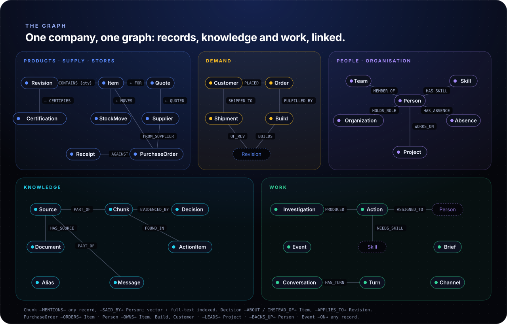

<details>
<summary><b>See the Cypher</b> (110 queries, all documented in <a href="docs/queries.md">docs/queries.md</a>)</summary>
<br>

Where a part is used, quantities multiplied along every path, blocked by draft or obsolete revisions:

```cypher
MATCH (prod:Item {kind:'product'})-[:HAS_REV]->(top:Revision)
MATCH p = (top)-[:CONTAINS*1..8]->(part:Item {id:$item_id})
WITH prod, top, p,
     [n IN nodes(p) WHERE n:Revision AND n.status <> 'released' | n.id] AS blocked,
     reduce(q = 1, r IN relationships(p) | q * r.qty) AS path_qty
RETURN prod.id AS product, top.id AS revision, sum(path_qty) AS qty_per_unit, blocked
```

A scenario runs on a disposable copy of the company:

```python
graph.copy(name)                       # FalkorDB GRAPH.COPY: about 0.1 s for the whole company
fork = get_graph(name)
_apply(fork, shocks)                   # the hypothetical changes, on the copy only
findings = _assess(fork, shocks, today)
fork.delete()                          # the real graph is never written
```

Chokepoints, averaged over ten sampling seeds so the ranking is stable:

```cypher
CALL algo.betweenness({nodeLabels:$labels, relationshipTypes:$rels, samplingSize:$size, samplingSeed:$seed})
YIELD node, score WHERE score > 0
RETURN node.id AS id, labels(node)[0] AS label, score
```

Hybrid search, semantic and keyword, over the same passages:

```cypher
CALL db.idx.vector.queryNodes('Chunk', 'embedding', $k, vecf32($v)) YIELD node, score RETURN node.id, score
CALL db.idx.fulltext.queryNodes('Chunk', $q) YIELD node, score RETURN node.id, score LIMIT $k
```

</details>

<br>

## ◆ Proof

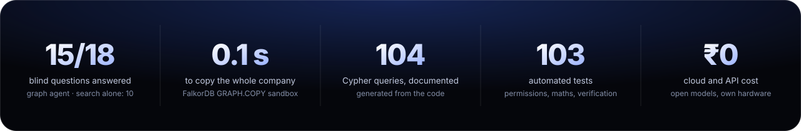

We wrote the expected answers before running anything and compared three systems on the same model
(ornith-1.5-35b-a3b on the DGX Spark). Every result and every failure is published in [docs/EVAL.md](docs/EVAL.md).

| | Graph agent | Search only | Whole corpus in the prompt |
|---|:-:|:-:|:-:|
| Blind set: 18 new questions, run once | **15** | 10 | 16 |
| Development set: 46 questions (graph agent after fixing its tools) | **46** | 28 | 43 |

The honest reading: the demo company is about 10,000 tokens, so a strong model can read all of it, and it does about as
well as the graph on lookups. The graph is what still works at a real company's size, does the arithmetic exactly, keeps
prices and leave from readers who may not see them, and is far ahead of search.

**Guardrails.** Cypher from the agent runs read-only with write keywords blocked and `LIMIT` enforced · a sentence
calling a part "approved" is checked against the graph · approvals and purchase orders are recomputed on the server, so
a browser cannot submit made-up tasks or prices · if FalkorDB is down the API returns `503`, never a guess.

<br>

## ◆ Built with

| Layer | Technology |
|---|---|
| Graph | **FalkorDB**: Cypher, vector and full-text indexes, graph algorithms, `GRAPH.COPY` |
| Models | **NVIDIA DGX Spark** serving **ornith-1.5-35b-a3b** with **vLLM** (OpenAI-compatible) · Qwen2.5-7B on Ollama as fallback · nomic-embed-text embeddings |
| Speech | **faster-whisper** (open-source Whisper, CTranslate2), on premises, primed with the graph's vocabulary |
| API | **Python 3.12** · **FastAPI** · Pydantic · a JSON plan-act agent with 27 tools |
| MCP | **Model Context Protocol** both ways: a local server with 16 tools, a remote Streamable HTTP server with 14 permission-filtered tools for cloud agents such as OpenAI Dots, ChatGPT and Claude (off until switched on in the app), and a client that syncs Zoho Inventory and Zoho Projects |
| Web | **Next.js 16** · **React 19** with View Transitions · **Tailwind CSS 4** with OKLCH tokens · **Motion** · Lenis · React Flow |
| Documents | **SuperDoc** (Word layout, tracked changes, .docx) · pdf.js |
| Operations | Docker Compose · Tailscale · Cloudflare Tunnel · **Playwright**, which captured every screenshot here |
| Film | Rendered frame by frame at 60 fps from an HTML scene graph with **Playwright**, scored with **numpy**, mixed with **ffmpeg** ([scripts/film](scripts/film)) |

Everything is free and open: no paid API, no cloud bill.

<br>

## ◆ Quick start

```bash
git clone https://github.com/SaiSiddharthBS/Neura1.git && cd Neura1
docker compose up -d falkordb                      # graph on :6380 · FalkorDB Browser on http://localhost:3001

cd api && cp .env.example .env && uv sync
uv run python -m neura1.cli load                   # load Flyvi Technologies and the saved, verified extractions
uv run pytest -q                                   # 122 tests
uv run uvicorn neura1.main:app --port 8000

cd ../web && pnpm install && pnpm dev              # http://localhost:3000, then "Take the tour"
```

<details>
<summary><b>Run the whole stack in Docker, including a model</b></summary>
<br>

```bash
docker compose --profile full --profile model up --build
docker compose exec ollama ollama pull qwen2.5:7b  # first time only
```

</details>

<details>
<summary><b>Connect a model: a laptop, or a GPU box such as a DGX Spark</b></summary>
<br>

Any OpenAI-compatible endpoint works. In `api/.env` (never committed):

```bash
NEURA1_LLM_BASE_URL=http://<your-dgx>:8080/v1      # vLLM on a DGX Spark over Tailscale, or Ollama
NEURA1_LLM_API_KEY=...
NEURA1_LLM_MODEL=ornith-1.5-35b-a3b
NEURA1_LLM_LABEL=DGX Spark
NEURA1_LLM_FALLBACK_BASE_URL=http://localhost:11435/v1   # used automatically if the main model is unreachable
NEURA1_LLM_FALLBACK_MODEL=qwen2.5:7b
NEURA1_LLM_EMBED_BASE_URL=http://localhost:11435/v1
NEURA1_LLM_EMBED_MODEL=nomic-embed-text
# NEURA1_STT_BASE_URL=...                          # optional: a remote transcription endpoint instead of local Whisper
# NEURA1_DEMO_PASSCODE=...                         # optional: require a passcode for changes
# NEURA1_ERP_MCP_URL=...                           # optional: a real Zoho MCP server instead of the simulated one
# NEURA1_ERP_SYNC_MINUTES=30                       # optional: sync the ERP and planner on a schedule
# NEURA1_AGENT_MCP_TOKEN=...                       # optional: turn on the remote MCP endpoint for cloud agents
# NEURA1_AGENT_ALERT_WEBHOOK=...                   # optional: post plan checks to a Slack or Teams channel
```

```bash
uv run python -m neura1.cli check-model            # chat · structured JSON · tool calling
uv run python -m neura1.cli extract                # read every document; raw outputs saved for replay
uv run python -m neura1.cli embed                  # semantic search
uv run python -m neura1.cli tag-skills             # tag work with the skills it needs (verified)
```

</details>

<details>
<summary><b>Repository map</b></summary>
<br>

```
api/neura1/
  queries.py · impact.py · engine/          change impact and the deterministic cost engine
  supply.py · promise.py · sandbox.py       lead times, "can we promise?", the GRAPH.COPY sandbox
  timeline.py                               the Gantt: baseline, plan and a forecast worked out by code
  connect/ · agent_mcp.py · alerts.py       ERP and planner sync over MCP; remote MCP for cloud agents; alerts
  departments.py                            one agent per department: goal, scoped engines, channel, permissions
  inventory.py · purchasing.py              stock ledger, forecasts, drafted and received purchase orders
  guard.py · knowledge_health.py            never the same mistake twice; living documents checked against the graph
  meetings.py · rescue.py                   recordings to verified decisions; knowledge capture interviews
  chat.py · brief.py · auto.py              messenger, daily briefs, the background reader on the DGX
  agent.py · mcp_server.py · search.py      Ask agent, MCP tools, hybrid search
  access.py · people.py · capabilities.py   permissions from the graph, organisation, capability map
  ingest/                                   validator, loaders, passages, verified extraction
api/tests/  api/eval/                       122 tests · frozen evaluation with a blind set
web/src/                                    Next.js app
fixture/flyvi/                              the synthetic company: records, chats, tickets, documents, samples, Zoho changes
docs/                                       evaluation, data model, Cypher reference, deployment, demo, video script
scripts/                                    Playwright captures, the public demo launcher, and the film (scripts/film)
```

</details>

<br>

## ◆ Graph Hacks

Main entry: **Track 03, Company Brain**. Also entered: Track 01, Agents That Act on Connected Data.

- [x] FalkorDB is the primary database and the core of the product
- [x] Public repository with setup instructions, the data model ([docs/data-model.md](docs/data-model.md)) and every Cypher query ([docs/queries.md](docs/queries.md))
- [x] Complete local setup, plus Docker for the whole stack
- [x] Built during the event (16–18 Oct 2026); earlier Neura1 work is described in [docs/REUSE.md](docs/REUSE.md)
- [x] AI assistance disclosed in [docs/AI_DISCLOSURE.md](docs/AI_DISCLOSURE.md)
- [x] Live deployment (link in the submission; see [docs/DEPLOY.md](docs/DEPLOY.md))
- [x] Demo video: [the Neura1 film](docs/demo/neura1-film-narrated.mp4) ([music-only cut](docs/demo/neura1-film-music.mp4))

<br>

## ◆ Licence

Free software under the [GNU Affero General Public License v3.0](LICENSE): use, study, change and share it; if you run
a modified version as a network service, offer its source to its users. SuperDoc, the embedded editor, uses the same
licence.

<br>

<div align="center">

<br>
<sub>Neura1 · built for Graph Hacks 2026 by <a href="https://github.com/SaiSiddharthBS">@SaiSiddharthBS</a> · synthetic data, real graph</sub>
</div>
