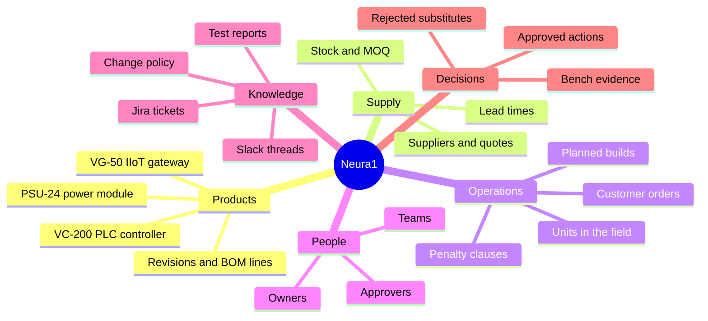
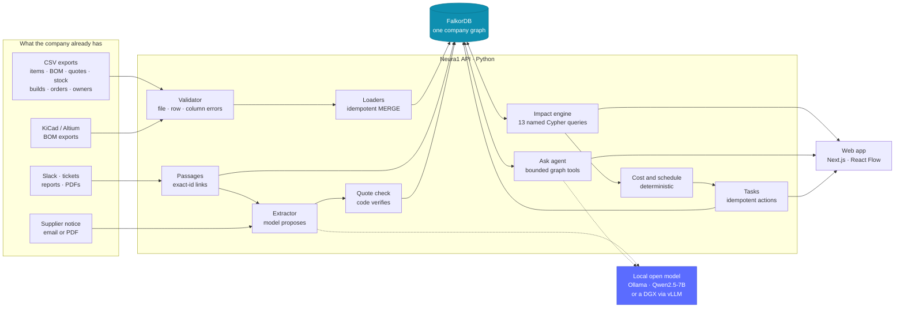
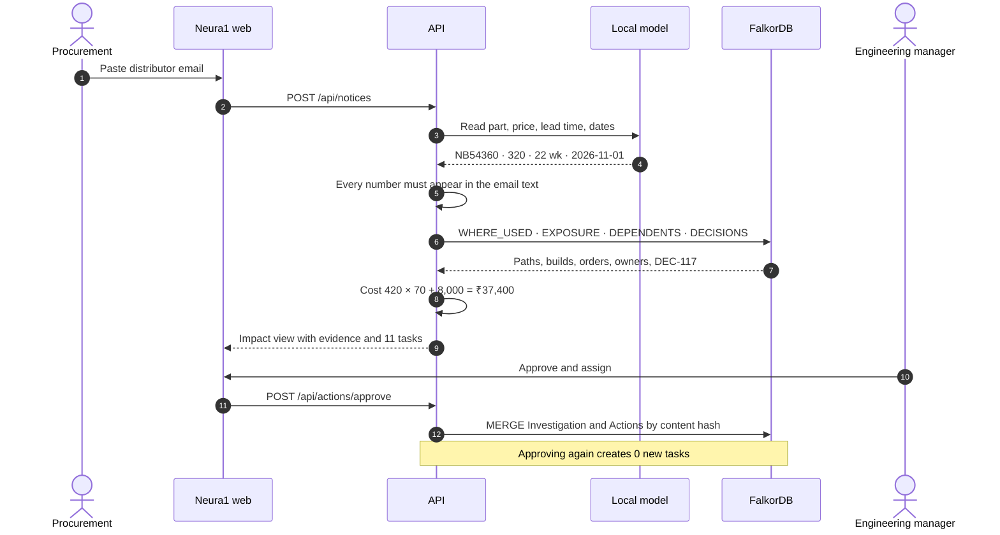
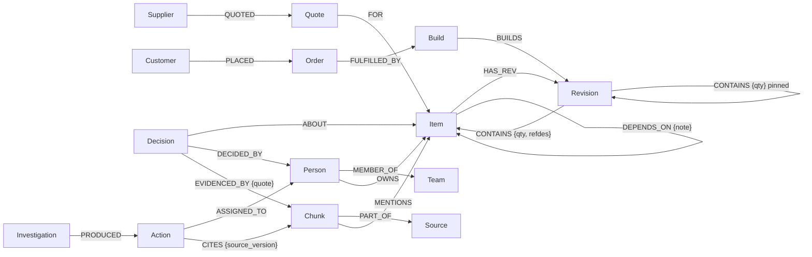
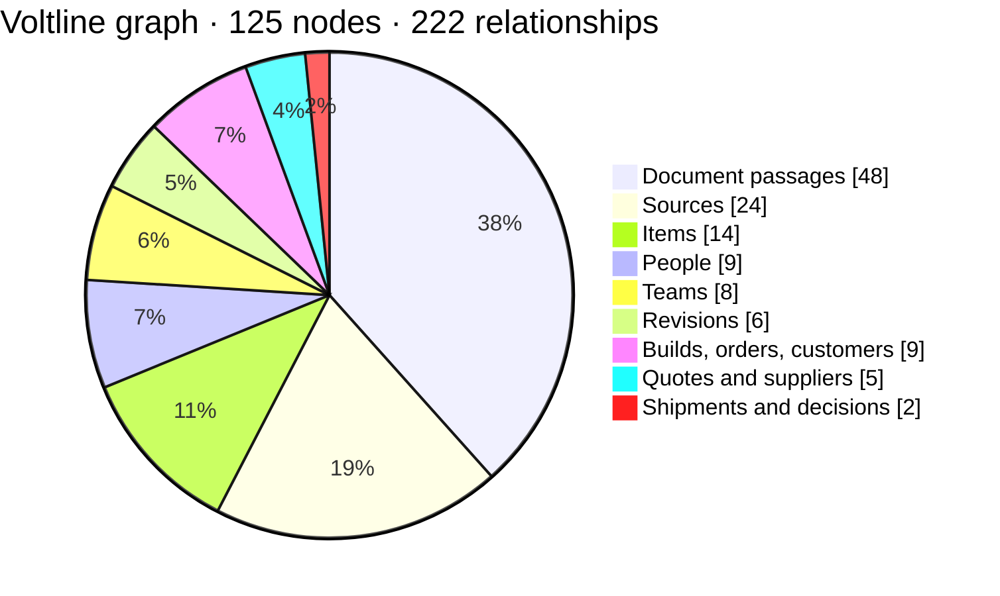
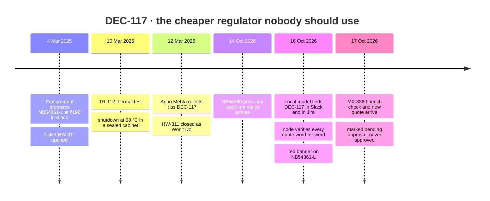

<div align="center">

<picture>
  <source media="(prefers-color-scheme: dark)" srcset="docs/readme/logo-dark.png">
  <source media="(prefers-color-scheme: light)" srcset="docs/readme/logo-light.png">
  
</picture>

### Know what a change breaks before it breaks.

The company brain for industrial electronics makers, built on **FalkorDB**.<br>
One supplier notice in. Every affected product, build, customer, decision and owner out, with the source for each.

<p>
  
  
  
</p>
<p>
  
  
  
  
  
  
  
</p>

[**Demo walkthrough**](docs/DEMO.md) · [**Data model**](docs/data-model.md) · [**Every Cypher query**](docs/queries.md) · [**Who it's for**](docs/target-customer.md) · [**Quick start**](#-quick-start)

</div>

<br>


> [!NOTE]
> Everything about the demo company, **Voltline Controls**, is synthetic: its people, parts, suppliers and customers.
> Every number in this README comes from the running system.

<br>

## ✦ The 30-second story

On 14 October 2026 a distributor emails Voltline. The **NB54360** 3.3 V regulator goes from **₹250 → ₹320**, and lead time
from **6 → 22 weeks**. Answering "what does this mean for us?" usually takes a day of spreadsheets and Slack searches.
Then someone suggests the cheaper, "pin-compatible" part that engineering rejected two years ago.

Neura1 answers in one view:


| | What Neura1 finds | How |
|---|---|---|
| 🔩 | **3 regulators per VC-200 Rev C**: two inside the PSU-24 module, one directly on the board (U12). **1 per VG-50.** Draft Rev D and obsolete Rev B excluded, with the reason. | One variable-length Cypher traversal with `reduce()` |
| 🏭 | **3 of 3 planned builds at risk.** 60 free parts cover part of the first build; supply ordered today lands around 19 Mar 2027. | Graph + deterministic stock allocation |
| 🤝 | **3 customer orders exposed.** Kaveri Water Utilities' SO-881 carries a late-delivery penalty (clause 9.2). | Build → order → customer → account manager |
| 💸 | **₹37,400 cost increase** = 420 × (₹320 − ₹250) + ₹8,000 requalification. The cheaper Q-099 quote expired on 30 June and is ignored. | `Decimal` maths in code, never the model |
| 🧠 | **"Do not switch to NB54361-L."** Rejected as **DEC-117** by Arjun Mehta on 12 Mar 2025, for thermal shutdown at 68 °C. Found in both Slack *and* Jira, quoted word for word. | Local model extracts, code verifies quotes |
| ✅ | **11 tasks for 7 people**, from the company's own change policy. Approve once, never duplicated, remembered next session. | Idempotent `Investigation` / `Action` nodes |

<br>

## ✦ See it

<table>
  <tr>
    <td width="50%"><br><sub><b>Impact workspace</b>: headline numbers, the rejected-part banner, the evidence graph and who needs to do what.</sub></td>
    <td width="50%"><br><sub><b>Evidence</b>: one click opens Arjun's Slack message, highlighted inside its thread.</sub></td>
  </tr>
  <tr>
    <td><br><sub><b>New facts arrive</b>: a bench result and a new quote. The approved investigation lists exactly what changed.</sub></td>
    <td><br><sub><b>Bring in a real company</b>: KiCad or Altium BOMs and spreadsheets, checked row by row before anything is written.</sub></td>
  </tr>
</table>

<details>
<summary><b>Every team, same graph: open the six department views</b></summary>
<br>

| Engineering | Procurement |
|---|---|
|  |  |
| **Production** | **Sales** |
|  |  |
| **Support** | **Management** |
|  |  |

</details>

<details>
<summary><b>Ask the company brain: a live answer from a local model</b></summary>
<br>


Every answer shows the tools it called and the Cypher they ran. A rule-based check flags any sentence that calls a
part *approved* when the graph says otherwise.

</details>

The full narrated walkthrough, with all 17 screens, is in **[docs/DEMO.md](docs/DEMO.md)**.

<br>

## ✦ Built for one kind of company

A company brain for everyone can't know what a BOM revision is, or why a cross-referenced part isn't approved.
Neura1 starts with **Indian industrial electronics product companies of 20–300 people** that design controllers,
gateways or instruments and build them in-house or at an EMS partner. [Why this market →](docs/target-customer.md)



| Who | When | Today | With Neura1 |
|---|---|---|---|
| Founder / Head of Ops (buyer)<br>Engineering, procurement, planning, sales, quality (users) | A supplier price, lead-time, end-of-life or last-time-buy notice | Forward the email. Search the BOM sheet. Dig through Slack. Planning and sales hear late. | Paste the email. Every team sees what it affects, what it costs, what was decided before, and who does what. |

<br>

## ✦ How it works



### The life of one notice



<br>

## ✦ Why FalkorDB is the product

Without the graph there is nothing to show. The core question is a variable-depth traversal that keeps only released
revisions, multiplies quantities along each path, and adds up repeated uses of the same part:

```cypher
MATCH (prod:Item {kind:'product'})-[:HAS_REV]->(top:Revision)
MATCH p = (top)-[:CONTAINS*1..8]->(part:Item {id:$item_id})
WITH prod, top, p,
     [n IN nodes(p) WHERE n:Revision AND n.status <> 'released' | n.id] AS blocked,
     reduce(q = 1, r IN relationships(p) | q * r.qty) AS path_qty
WITH prod, top,
     sum(CASE WHEN size(blocked) = 0 THEN path_qty ELSE 0 END) AS qty_per_unit,
     collect({nodes: [n IN nodes(p) | n.id], qty: path_qty, blocked_by: blocked}) AS paths
RETURN prod.id AS product, top.id AS revision, qty_per_unit, paths
```

From there the analysis keeps crossing domains with no fixed join path: builds, orders, customers and account
managers; firmware and test owners; alternates, the decisions about them, the passages that prove those decisions,
and the people who said them.


**FalkorDB features in use:**
- variable-length paths;
- `reduce()` and list comprehensions over `nodes(p)` and `relationships(p)`;
- the full-text index (`db.idx.fulltext`) over every document passage;
- read-only parameterised queries (`GRAPH.RO_QUERY`);
- indexes on every id.

Vector indexes (`vecf32`, `db.idx.vector`) are tested and ready for embeddings.

<details>
<summary><b>The graph schema</b></summary>
<br>



Full description, with authority rules and modelling choices, in **[docs/data-model.md](docs/data-model.md)**.

</details>



<br>

## ✦ How a two-year-old decision came back



<br>

## ✦ Guardrails

A tool that tells a company which part to use has to be careful about what it lets the model decide.

| The model may | The model may not |
|---|---|
| Read a supplier notice into fields | Invent a number. Every value must appear in the notice text. |
| Propose decisions found in chats and tickets | Write a decision whose quote isn't word for word in its source |
| Pick which graph tool to call next | Write to the graph. Cypher runs read-only, write keywords are blocked, `LIMIT` is enforced. |
| Phrase an answer from tool results | Call a part approved. A rule-based check flags any such sentence the graph contradicts. |
| | Do arithmetic, pick quotes, allocate stock or approve tasks. Code and people do those. |

**Other safeguards:**
- If FalkorDB is unreachable, the API returns `503 graph_unavailable`. It never pretends to have traversed the graph.
- A chat message can record a rejection but can never approve a part.
- Approvals are re-computed on the server, so a browser can't submit made-up tasks.

<br>

## ✦ Quick start

> [!TIP]
> Everything below is free and runs on one machine. No paid API keys.

```bash
git clone https://github.com/SaiSiddharthBS/Neura1.git && cd Neura1
docker compose up -d falkordb                      # graph on :6380 · FalkorDB Browser on http://localhost:3001

cd api
cp .env.example .env                               # set NEURA1_DEMO_PASSCODE
uv sync
uv run python -m neura1.cli load                   # load Voltline Controls + saved model extractions
uv run pytest -q                                   # 31 tests
uv run uvicorn neura1.main:app --port 8000

cd ../web && pnpm install && pnpm dev              # http://localhost:3000
```

<details>
<summary><b>Run the whole stack in Docker, including the model</b></summary>
<br>

```bash
docker compose --profile full --profile model up --build
docker compose exec ollama ollama pull qwen2.5:7b  # first time only
```

Open http://localhost:3000. The API seeds the demo company on first start.

</details>

<details>
<summary><b>Connect a model (local CPU, or a GPU box such as a DGX Spark)</b></summary>
<br>

Any OpenAI-compatible endpoint works. In `api/.env`:

```bash
NEURA1_LLM_BASE_URL=http://localhost:11435/v1      # Ollama in Docker, or http://<dgx>:8000/v1 for vLLM
NEURA1_LLM_MODEL=qwen2.5:7b
NEURA1_LLM_TIMEOUT=900                             # CPU models are slow; a GPU needs far less
```

```bash
uv run python -m neura1.cli check-model            # chat · structured JSON · tool calling
uv run python -m neura1.cli extract                # read every document; raw outputs saved for replay
uv run python -m neura1.cli load                   # verified decisions enter the graph
```

The agent uses a JSON plan-act loop, so it works even on servers whose native tool calling is unreliable.

</details>

<br>

## ✦ Proof, not promises

| Check | Result |
|---|---|
| Automated tests | **31 passing**: BOM roll-ups, revision applicability, cost edge cases, import validation, CAD BOMs, extraction verification, idempotent approvals, the HTTP flow end to end, and 503 when the graph is down |
| Local model on real fixture documents | DEC-117 found in **Slack and Jira** ✓ · notice read correctly ✓ · MX-3360 bench result ✓ · TR-131 bench note **missed** ✗ · [full table](docs/DEMO.md#what-the-local-model-got-right-and-wrong) |
| Mistakes caught and fixed | The agent once called MX-3360 "approved". That led to the approval wording in tool output and the rule-based check. |
| Frozen evaluation | 32 ground-truth questions in [`api/eval/golden.yaml`](api/eval/golden.yaml), written before any model ran: graph agent vs search-only vs whole-corpus, same model. **Results pending GPU time; failures will be published, not hidden.** |

<br>

## ✦ Zero-cost, open stack

| Layer | Choice | Licence |
|---|---|---|
| Graph | FalkorDB, self-hosted in Docker | Source-available (SSPLv1), free |
| Model runtime | Ollama, or vLLM on a DGX Spark | MIT · Apache-2.0 |
| Model | Qwen2.5-7B-Instruct | Apache-2.0 |
| API | Python 3.12 · FastAPI · pypdf | MIT · BSD |
| Web | Next.js 16 · React 19 · React Flow · dagre · Tailwind CSS | MIT |
| Automation | Playwright, which captured every screenshot here | Apache-2.0 |

<br>

## ✦ Repository

```
api/                 FastAPI service
  neura1/queries.py    every Cypher query the product depends on
  neura1/impact.py     the change-impact analysis
  neura1/engine/       deterministic cost engine
  neura1/ingest/       loaders · validator · document passages · verified extraction
  neura1/agent.py      Ask agent with bounded tools and guardrails
  tests/  eval/        31 tests · 32-question frozen evaluation
web/                 Next.js app: Inbox · Impact · Company brain · Investigations · Import
fixture/voltline/    synthetic company: records · chats · tickets · docs · notice · updates · model extractions
docs/                demo walkthrough · data model · queries · target customer · reuse · AI disclosure
scripts/             Playwright demo capture
```

<br>

## ✦ Graph Hacks compliance

Main entry: **Track 03, Company Brain**. Also entered: Track 01, Agents That Act on Connected Data.

- [x] FalkorDB is the primary database and the core of the product
- [x] Public repository, with setup instructions and the graph data model ([docs/data-model.md](docs/data-model.md))
- [x] The Cypher queries the product depends on ([docs/queries.md](docs/queries.md), generated from code)
- [x] Complete local setup, plus Docker for the whole stack
- [x] Built during the event (16–18 Oct 2026). Prior Neura1 work is described in [docs/REUSE.md](docs/REUSE.md).
- [x] AI assistance disclosed in [docs/AI_DISCLOSURE.md](docs/AI_DISCLOSURE.md)
- [ ] Demo video
- [ ] Live deployment

<br>

<div align="center">


<sub>Neura1 · built for Graph Hacks 2026 by <a href="https://github.com/SaiSiddharthBS">@SaiSiddharthBS</a> · synthetic data, real graph</sub>
</div>
