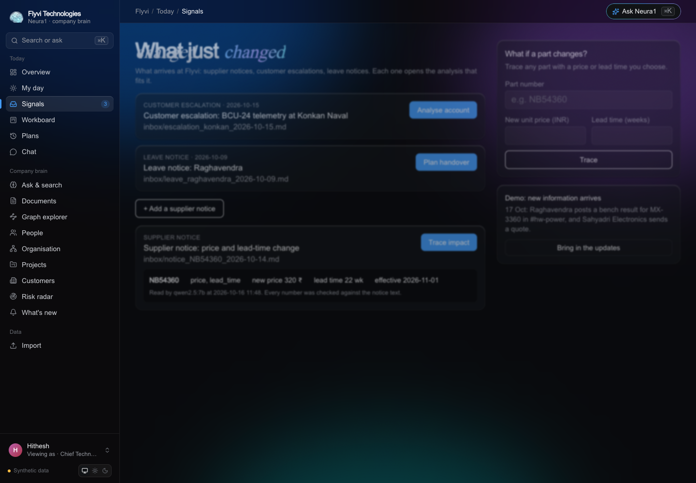
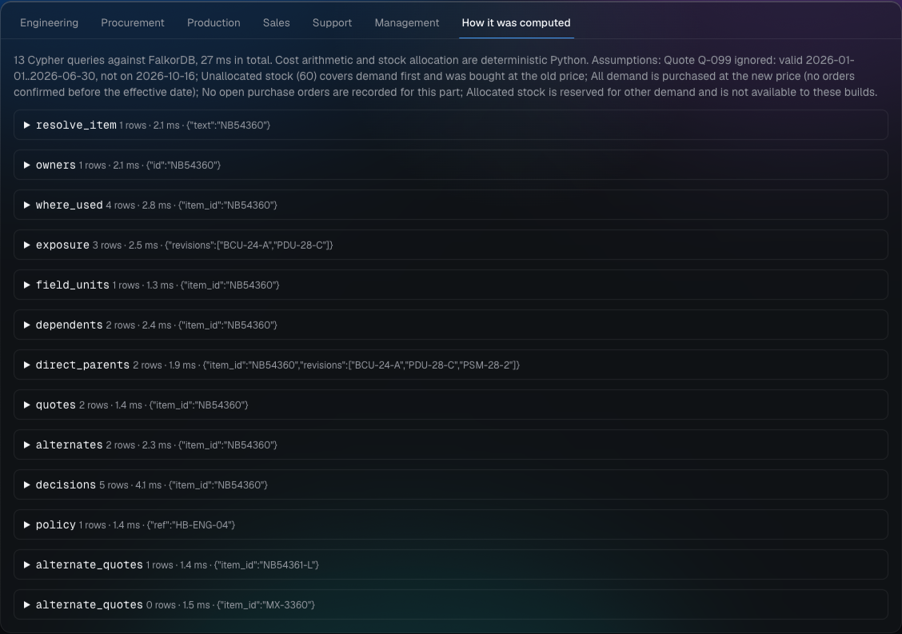
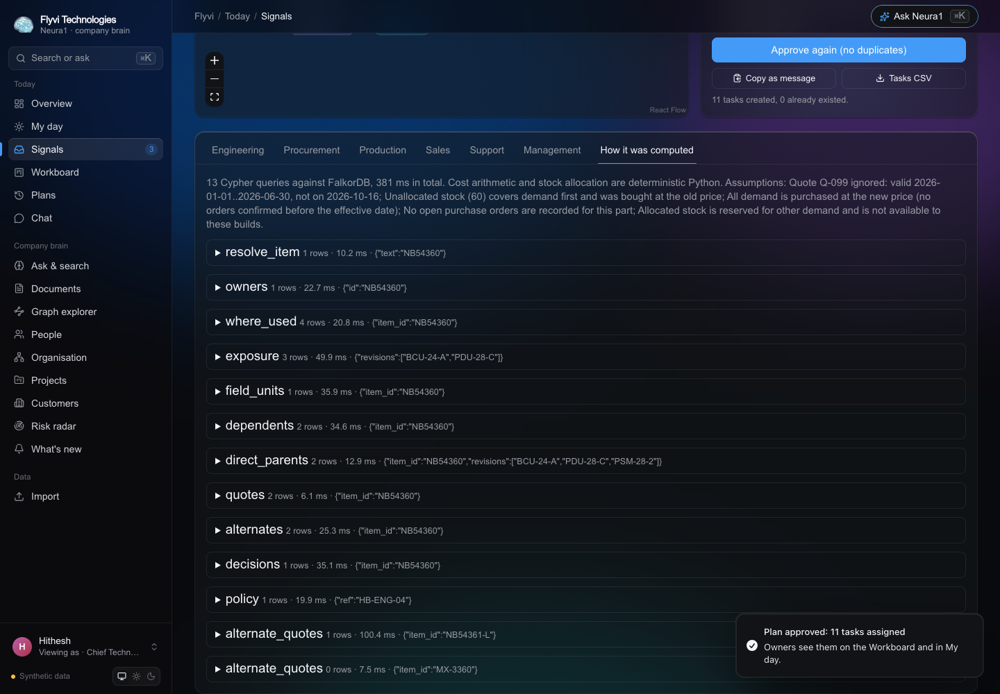
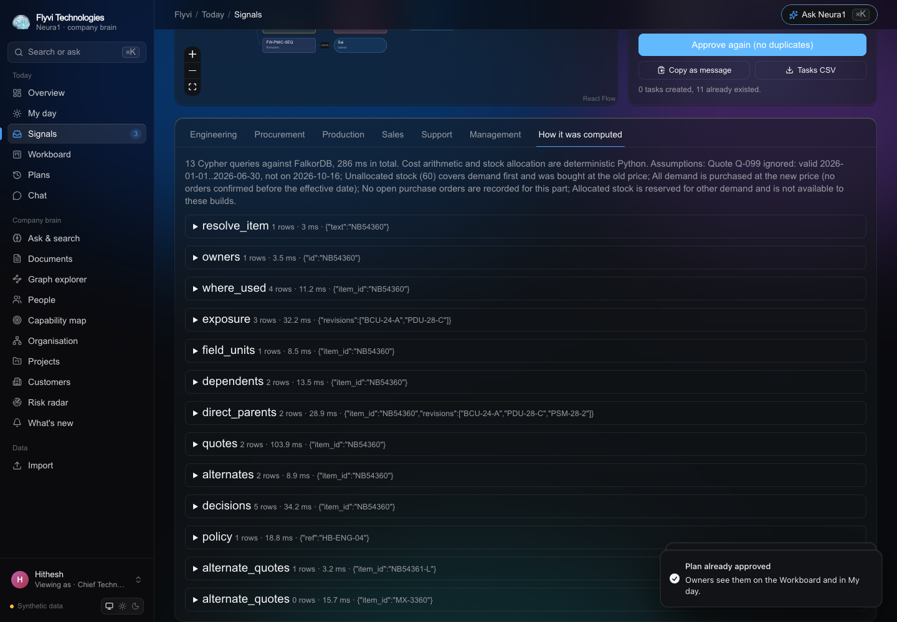
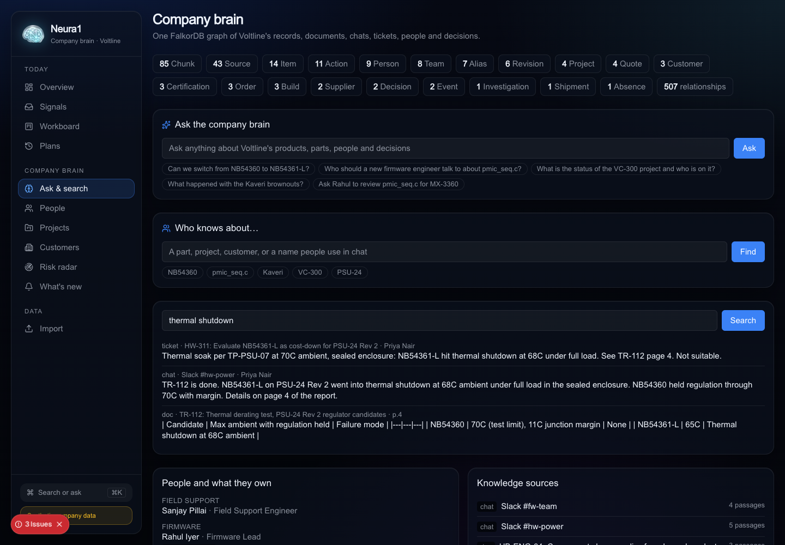
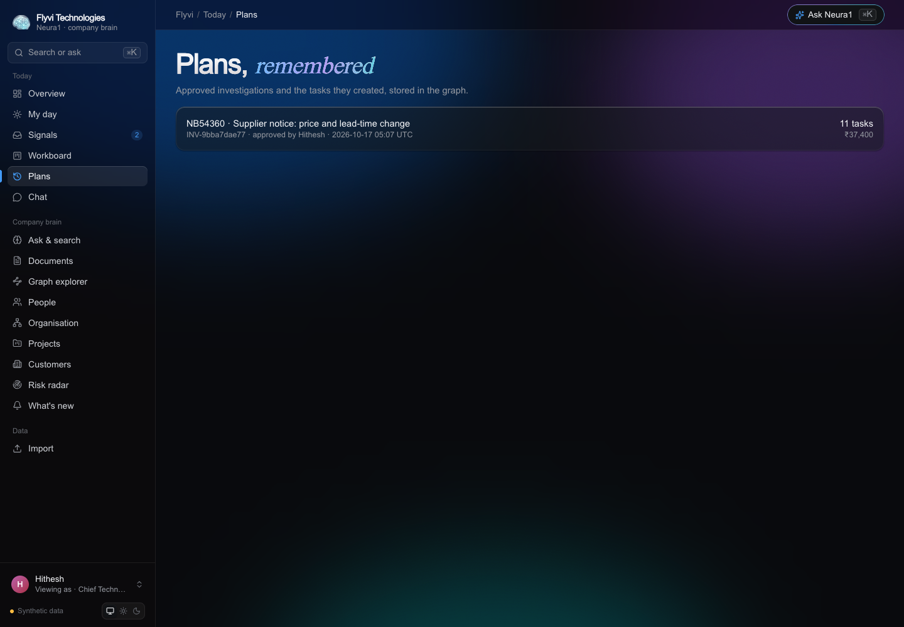

# Neura1 demo: one supplier notice, the whole company

**Customer:** Flyvi Technologies (synthetic), a 60-person industrial electronics company in Pune. It makes the
PDU-28 power distribution unit and the BCU-24 battery charger, assembled at an EMS partner.

**Trigger:** on 14 October 2026 the distributor emails: the NB54360 3.3 V regulator goes from ₹250 to **₹320**,
lead time from 6 to **22 weeks**, with a last-time-buy date.

Every screenshot below was captured by [`scripts/capture_demo.py`](../scripts/capture_demo.py), which clicks
through the running app like a user. Nothing is mocked.

---

## 1. The notice arrives

The procurement lead pastes the email or uploads the PDF on the Inbox. A local open-source model
(Qwen2.5-7B through Ollama, no paid API) reads the part, price, lead time and dates. **Code then checks every
number against the notice text.** If the model invents ₹330, the notice is flagged and cannot be traced. With no
model at all, a person types the facts and the same check applies.

If the notice names a part Neura1 doesn't know exactly (for example `NB54360-T/R`, the tape-and-reel variant),
it suggests `NB54360` and asks. It never picks silently.

## 2. One view of what it means

One FalkorDB traversal goes from the part, through the PSM-28 power stage module, to every product revision, build,
customer order and owner:

- **2 product revisions affected.** PDU-28 Rev C uses **3 per unit** (two PSM-28 modules with one regulator each,
  plus one directly on the board at U12). BCU-24 Rev A uses 1. The draft Rev D and obsolete Rev B are greyed out,
  with the revision that excluded them.
- **3 of 3 builds at risk.** 60 units of free stock cover part of the first build. New supply ordered today
  arrives around 2027-03-19, after every planned build date.
- **3 customer orders exposed.** Nilgiri Aero Systems' SO-881 has a late-delivery penalty (clause 9.2).
- **Cost increase ₹37,400** = 420 parts to buy × ₹70 + ₹8,000 requalification. The cheaper Q-099 quote is ignored
  because it expired on 30 June.
- **7 people, 11 tasks**, from the company's own change policy (HB-ENG-04).

## 3. What the company already decided

In March 2025, procurement suggested the cheaper, "pin-compatible" NB54361-L. It failed thermal testing at 68 °C
in a sealed enclosure, and the engineering manager rejected it in Slack (DEC-117). That decision lives nowhere
except a chat thread and a ticket.

A free local model (Qwen2.5-7B on a laptop CPU) read the Slack thread **and**, separately, the Jira ticket HW-311.
It found the same decision in both: DEC-117, decided by Vishwas on 2025-03-12, for failing thermal derating at
70 °C. **Code verified each quote word for word against its source** before writing it, so the one `Decision` node
now carries four passages from two independent systems. Neura1 shows a red banner on the exact alternate a busy team
would reach for: **"Do not switch to NB54361-L."** One click opens the original message, highlighted, with the
thread around it.

A chat message can record a rejection. It can never approve a part. Only a person in Neura1 can.

## 4. Every team, same graph

| Engineering | Procurement |
|---|---|
|  |  |
| **Production** | **Sales** |
|  |  |
| **Support** | **Management** |
|  |  |

- **Engineering:** where-used paths with reference designators. The firmware module `pmic_seq.c` assumes this
  regulator's 4 ms soft-start (ticket FW-233, owner Sai). The test procedure TP-PSM-07 must be rerun
  (owner Satish).
- **Procurement:** every quote with validity, the baseline used, stock, net need and MOQ.
- **Production:** each build's need, coverage from stock, shortfall and supply date.
- **Sales:** orders, due dates, the penalty clause and the account manager.
- **Support:** 220 Rev B controllers already at Nilgiri contain this part; spares will need the new lead time.
- **Management:** a summary generated from the query results, not by a language model.

## 5. Nothing is a black box

Every Cypher query that built the page, with its parameters, row count and time (13 queries, about 30 ms in total).

## 6. Assign the work, once

*Approve and assign tasks* re-runs the analysis on the server and stores an `Investigation` and 11 `Action` nodes in
the graph. Each is assigned to its owner and cites the source passages and their versions. *Copy as message* pastes a
per-person task list into Slack, Teams, WhatsApp or email; *Tasks CSV* downloads it.

Approving again creates **0 new tasks**: ids are content hashes. Reloading the page in a new session shows the
investigation is already approved, by whom and when.

## 7. New information arrives

On 17 October, Raghavendra posts a bench result for the MX-3360 alternate in Slack, and Sahyadri Electronics sends a quote
at ₹265. After *Bring in the updates*, the approved investigation lists exactly **what changed since approval**.
MX-3360 becomes a *candidate pending approval*, not "approved", because a bench check in chat is not a TP-PSM-07
qualification.

## 8. Ask anything

The company brain page shows everyone, what they own, every source, and full-text search across all passages.
*Ask* uses the same model with bounded graph tools (where-used, dependents, exposure, alternates, decisions,
quotes, people, document search) and one guarded read-only Cypher tool. Every answer shows its tool calls and queries.

## 9. History

## 10. Bring in a real company

The target customer already has the data: a BOM exported from **KiCad or Altium**, an item master, quotes, stock,
builds and orders in spreadsheets, decisions in Slack and tickets. Drop the files in. Neura1 understands
CAD-tool column names ("Reference", "Manufacturer Part Number") and semicolon-separated files, and matches parts by
manufacturer part number. It reports every problem by file, row and column (here: an assembly with no pinned
revision, and a quantity written as "two"). Nothing is written until the import is clean.

---

## What the local model got right and wrong

Run on 16 Oct 2026 with `qwen2.5:7b` in Ollama (Docker, CPU only, Intel i7-9750H). Raw outputs are in
[`fixture/flyvi/extracted/`](../fixture/flyvi/extracted/).

| Document | Expected | Model output | Kept after verification |
|---|---|---|---|
| Slack #hw-power, Mar 2025 | DEC-117 rejection | Rejection, DEC-117, Vishwas, 2025-03-12, 2 quotes | Yes |
| Ticket HW-311 | DEC-117 rejection | Same decision, 2 quotes | Yes (merged into DEC-117) |
| Supplier notice | NB54360, ₹320, 22 wk, 2026-11-01 | All correct; currency written as "₹" (mapped to INR by code) | Yes |
| HB-ENG-04 policy | No decision | No decision | n/a |
| Slack #hw-power, 17 Oct | MX-3360 bench result (evidence only) | Found after adding a bench-result example to the prompt; the first prompt missed it | Yes |
| TR-131 bench note | MX-3360 bench result | **Missed** (returned nothing) | n/a |
| TP-PSM-07, TR-112, contract, ops review, FW-233 | No new decisions expected | Not yet run: about 10–14 min per document on this CPU | n/a |

Speed: about 25 s for a short JSON answer and 10–14 min for a long extraction prompt on this laptop. The same
endpoint pointed at a GPU (e.g. a DGX Spark serving through vLLM) needs no code change.

---

## Video script (about 3 minutes)

| Time | Show | Say |
|---|---|---|
| 0:00 | Inbox | "Hardware companies run on a bill of materials. When one chip changes, every team is affected, and the reasons behind old choices are buried in Slack." |
| 0:15 | Paste notice | "A distributor emails a price and lead-time change. Neura1 reads it with a local open-source model, and code checks every number against the email." |
| 0:35 | Impact overview, graph | "One FalkorDB traversal: through the power module to two released products. Three per controller, because the module is fitted twice and the chip is also on the board. Drafts and obsolete revisions excluded." |
| 1:00 | Red banner → Slack evidence | "The cheaper pin-compatible part was rejected two years ago, in Slack. Neura1 found the decision, verified the quote word for word, and stops us repeating the mistake." |
| 1:30 | Lenses | "Same graph, every team: firmware owner, quotes and stock, builds short, Nilgiri's penalty clause, units in the field." |
| 2:00 | Cypher tab | "Every query is visible: 13 queries, about 30 ms." |
| 2:10 | Approve, approve again | "Approve: eleven tasks, each with an owner and a source. Approve again: nothing duplicated." |
| 2:25 | Bring in updates → changed banner | "New quote and bench result arrive. The approved investigation shows exactly what changed, and a chat message still can't approve a part." |
| 2:45 | Import with errors | "And a real company starts here: its KiCad BOM and spreadsheets, checked row by row." |
| 2:55 | Architecture | "FalkorDB, open-source models, no paid APIs. Neura1." |
