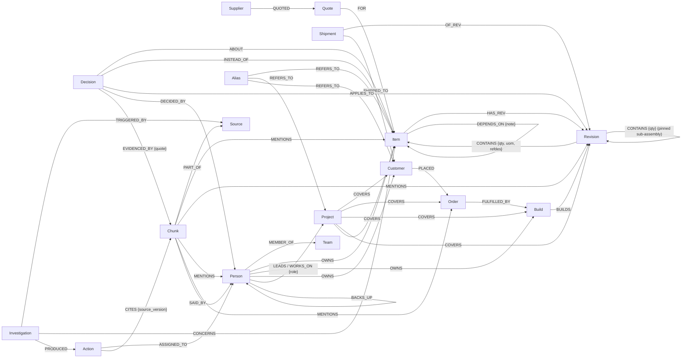

# Graph data model

One FalkorDB graph per company (`flyvi` in the demo). Every node and relationship that comes from a
company record carries `source` (which export or document it came from) and `authority`.

## Authority levels

| `authority` | Meaning | Can it approve a part? |
|---|---|---|
| `system_of_record` | Loaded from the company's exports (BOM, quotes, orders…) | n/a |
| `source_document` | A chat, ticket, report or notice, stored as passages | No |
| `extracted` | A decision or claim a model found in a document, **kept only if its quote is verbatim in the passage** | No |
| `approved` | Confirmed by a person in Neura1 | Yes |

A newer timestamp never overrides an approval. Only an explicit superseding decision can.

## Schema

## Node labels

| Label | Key properties | Notes |
|---|---|---|
| `Item` | `id`, `kind` (product · assembly · part · firmware · test), `mpn`, `manufacturer`, `on_hand`, `allocated` | One label for everything with a part number, so dependencies are uniform |
| `Revision` | `id`, `rev`, `status` (draft · released · obsolete), `effective_from` | BOM lines hang off revisions, not items |
| `Supplier`, `Quote` | `unit_price`, `currency`, `moq`, `lead_weeks`, `valid_from`, `valid_until` | Expired quotes stay in the graph but are never used as a baseline |
| `Build`, `Order`, `Customer`, `Shipment` | quantities and dates; `Order.penalty_note` | |
| `Person`, `Team` | `name`, `role` | Ownership is a relationship, so "who owns this?" is one hop |
| `Source` | `kind` (export · chat · ticket · doc · notice), `title`, `version` (content hash), `ref` (e.g. TR-112) | |
| `Chunk` | `text`, `author`, `ts`, `page`, `source_version` | A passage: one Slack message, one ticket comment, one paragraph. Full-text indexed |
| `Decision` | `outcome` (approved · rejected · proposed · evidence), `summary`, `reason`, `decided_at`, `authority`, `extracted_by` | |
| `Investigation`, `Action` | content-hash ids, `status`, `approved_by`, `created_at` | Idempotent: re-approving finds the same nodes |
| `Project` | `name`, `status`, `start_date`, `target_date`, `summary` | Linked to people (`LEADS`, `WORKS_ON {role}`) and to whatever it covers |
| `Alias` | `term` | Names people actually use in chat ("pmic_seq.c", "Nilgiri") that point at a record |
| `Organization` | `name`, `kind` | Datasol (parent) and Flyvi (`SUBSIDIARY_OF`); people `HOLDS_ROLE {role}` (Founder & Managing Director, President & Executive Officer, directors, COO, CTO, General Manager); teams are `PART_OF` an organisation |
| `Skill` | `name` | `Person-HAS_SKILL->Skill`; stated skills sit alongside knowledge derived from work |
| `Absence` | `start_date`, `end_date`, `kind` | `Person-HAS_ABSENCE->Absence`; visibility follows the reporting chain |
| `Certification` | `standard`, `valid_until` | `CERTIFIES` a revision; `RETEST_IF_CHANGED` an item |
| `Event` | `kind`, `at`, `by` | Task moves and profile edits, linked `ON` the record they changed |
| `Skill` | `name` | People `HAS_SKILL` (stated). Tasks (`Action`) and projects `NEEDS_SKILL` a skill, tagged by the model from Flyvi's own list and verified by code (`by`, `model`, `authority: extracted`). Expertise is derived from tasks a person finished or is doing; no scores are stored. |
| `Document` | `title`, `kind` (blank · change_notice · customer_response · handover · import), `version`, `audience` (everyone · money · leave:<person>) | `CREATED_BY` a person, `ABOUT` the record a template was written for, `HAS_SOURCE` its text projection (a `Source` of kind `document` whose passages link to what it names). The .docx itself is kept in `data/documents/`. |
| `Conversation`, `Turn` | `question`, `answer`, `at` | Ask memory; turns `CITED` passages and are `ABOUT` records |
| `ActionItem` | `task`, `due`, `quote` | Meeting action items, `FOUND_IN` a passage, `FOR` a person |

Relationships not in the diagram above: `REPORTS_TO`, `BACKS_UP`, `IN_PROJECT` (work items), `ASSIGNED_TO` (tickets and
tasks), `SUBSIDIARY_OF`, `HOLDS_ROLE`, `HAS_SKILL`, `HAS_ABSENCE`, `CERTIFIES`, `RETEST_IF_CHANGED`, `ON`, `STARTED`,
`HAS_TURN`, `CITED`, `FOUND_IN`.

## Who knows what

Expertise is not stored. It is derived from the graph every time, with the evidence for each signal
([`WHO_KNOWS`](queries.md#who_knows)):

| Signal | Weight |
|---|---|
| Owns it, or leads the project | 5 |
| Made a recorded decision about it or its alternates | 4 |
| Owns something that depends on it | 3 |
| Works on the project | 3 |
| Owns an assembly that uses it · works on a project that covers it · backs up the owner | 2 |
| Each passage they wrote that mentions it | 1 |

## Keeping knowledge current

- **Re-importing a document updates its passages in place.** Links from decisions and tasks survive.
- **Each passage carries a `text_hash`.** `EVIDENCED_BY` and `CITES` store the hash they relied on. If the passage is
  edited later, the mismatch is flagged as "edited after it was relied on".
- **A passage that disappears is deleted, unless something cites it.** In that case it stays, marked `retracted_at`, and
  is flagged.
- **Each source keeps `previous_version` and `updated_at`.**
- **The "needs attention" list also flags** decisions that apply to revisions no longer released, quotes expiring
  within 90 days, and builds or customers with no owner.

## Why a graph

- **BOMs are variable-depth and many-to-many.** "Where is this part used, how many per unit, on which released
  revisions?" is one variable-length traversal with `reduce()` over relationship quantities
  (see [`WHERE_USED`](queries.md#where_used)). Repeated occurrences of a part are separate paths and are summed.
- **The impact crosses domains with no fixed join path.** Part → assembly revision → product revision → build →
  order → customer → account manager, and separately part → firmware module → owner, and part → alternate →
  decision → evidence passage → Slack message.
- **Provenance is structure, not a column.** A decision links to the passages that support it, and an approved
  action links to the exact source versions it relied on.

## Modelling choices

- **Assemblies are pinned by revision.** A BOM line to an assembly points at the specific sub-assembly revision
  (`Revision-CONTAINS->Revision`). A product revision released with PSM-28 Rev 2 keeps meaning Rev 2.
- **Applicability is computed, not stored.** A path counts only if every revision on it is `released`, and the
  query reports which revision blocked an excluded path.
- **Cross-references are not approvals.** `ALTERNATE_OF.basis` records why an alternate is listed.
  Only `Decision` nodes change its status.
