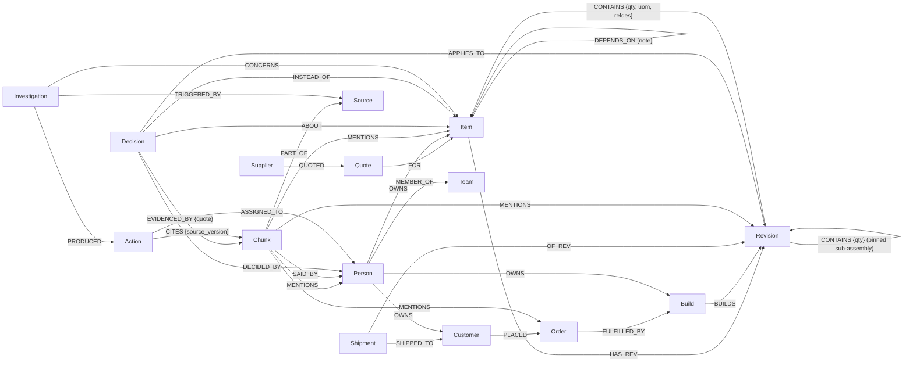

# Graph data model

One FalkorDB graph per company (`voltline` in the demo). Every node and relationship that comes from a
company record carries `source` (which export or document it came from) and `authority`.

## Authority levels

| `authority` | Meaning | Can it approve a part? |
|---|---|---|
| `system_of_record` | Loaded from the company's exports (BOM, quotes, orders…) | n/a |
| `source_document` | A chat, ticket, report or notice, stored as passages | No |
| `extracted` | A decision or claim a model found in a document, **kept only if its quote is verbatim in the passage** | No |
| `approved` | Confirmed by a person in Neura1 | Yes |

A newer timestamp never overrides an approval. Only an explicit superseding decision can.

## Schema

## Node labels

| Label | Key properties | Notes |
|---|---|---|
| `Item` | `id`, `kind` (product · assembly · part · firmware · test), `mpn`, `manufacturer`, `on_hand`, `allocated` | One label for everything with a part number, so dependencies are uniform |
| `Revision` | `id`, `rev`, `status` (draft · released · obsolete), `effective_from` | BOM lines hang off revisions, not items |
| `Supplier`, `Quote` | `unit_price`, `currency`, `moq`, `lead_weeks`, `valid_from`, `valid_until` | Expired quotes stay in the graph but are never used as a baseline |
| `Build`, `Order`, `Customer`, `Shipment` | quantities and dates; `Order.penalty_note` | |
| `Person`, `Team` | `name`, `role` | Ownership is a relationship, so "who owns this?" is one hop |
| `Source` | `kind` (export · chat · ticket · doc · notice), `title`, `version` (content hash), `ref` (e.g. TR-112) | |
| `Chunk` | `text`, `author`, `ts`, `page`, `source_version` | A passage: one Slack message, one ticket comment, one paragraph. Full-text indexed |
| `Decision` | `outcome` (approved · rejected · proposed · evidence), `summary`, `reason`, `decided_at`, `authority`, `extracted_by` | |
| `Investigation`, `Action` | content-hash ids, `status`, `approved_by`, `created_at` | Idempotent: re-approving finds the same nodes |

## Why a graph

- **BOMs are variable-depth and many-to-many.** "Where is this part used, how many per unit, on which released
  revisions?" is one variable-length traversal with `reduce()` over relationship quantities
  (see [`WHERE_USED`](queries.md#where_used)). Repeated occurrences of a part are separate paths and are summed.
- **The impact crosses domains with no fixed join path.** Part → assembly revision → product revision → build →
  order → customer → account manager, and separately part → firmware module → owner, and part → alternate →
  decision → evidence passage → Slack message.
- **Provenance is structure, not a column.** A decision links to the passages that support it, and an approved
  action links to the exact source versions it relied on.

## Modelling choices

- **Assemblies are pinned by revision.** A BOM line to an assembly points at the specific sub-assembly revision
  (`Revision-CONTAINS->Revision`). A product revision released with PSU-24 Rev 2 keeps meaning Rev 2.
- **Applicability is computed, not stored.** A path counts only if every revision on it is `released`, and the
  query reports which revision blocked an excluded path.
- **Cross-references are not approvals.** `ALTERNATE_OF.basis` records why an alternate is listed.
  Only `Decision` nodes change its status.
